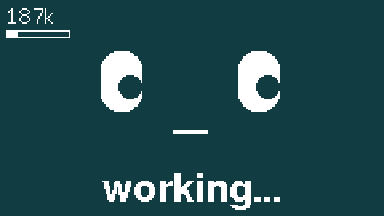
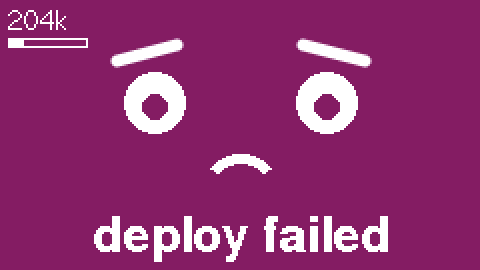
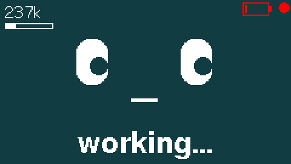
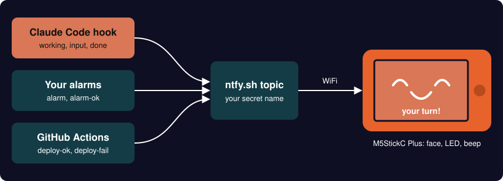

# Claude Buddy

M5StickC Plus desk buddy. Shows a face for what Claude Code is doing, and blinks the red LED and chirps
when Claude is done or needs you. Also shows Lambda alarms and deploy results.


Images are rendered from the firmware's own drawing code.

| Screen | Face | Meaning | Sent by |
|---|---|---|---|
|  | Sleeping, dim | idle / you said "got it" | button A or a shake |
|  | Eyes looking around, "working..." | Claude is working | hooks `UserPromptSubmit`, `PostToolUse` |
|  | Orange, ^ ^ bouncing, LED blinks, chirp | **done, your turn** | hook `Stop` |
|  | Yellow, wide eyes, LED blinks, double beep | **needs input** (permission prompt / waiting) | hook `Notification` |
|  | Red, worried, "lambda alarm" | a CloudWatch alarm fired; clears on recovery | your own alarm Lambda (posts `alarm` / `alarm-ok`) |
| <br> | Purple, worried, "deploy failed" / green "deployed!" (8 s) | GitHub Actions deploy result | workflow step (below) |



Corner markers: **`237k` + bar** (top left) = context window used at the last done/input; **battery icon** (top
right) only when running on battery, red under 20 %, one low beep at 15 %; **red dot** = no connection to ntfy.

Alarm and deploy-failed faces stay on top of the Claude faces until you acknowledge them (or the alarm recovers).

## How it works



```
Claude Code hook / alarm Lambda / workflow --curl--> ntfy.sh/<topic> <--HTTPS stream-- M5Stick on WiFi
```

Nothing connects to the Stick, so it works on any network with internet: work WiFi with client isolation, a
laptop on VPN, home, anywhere. Messages are only short words posted to your own unguessable topic. No project names, alarm names or code leave the machine.

Message words: `working`, `done [usedK/maxK]`, `input [usedK/maxK]`, `idle`, `alarm`, `alarm-ok`, `deploy-ok`,
`deploy-fail`, `ota <hmac>` (firmware update, see below).

## Controls

- **A (big front button)** or **shake it**: "got it". Clears an alarm/deploy face first, then goes back to sleep.
- **Lay it face-down**: screen off and no beeps while it stays that way.
- **B (side button) held 3 s**: forget WiFi and reopen setup.

Calibration knobs at the top of `src/main.cpp`: `SHAKE_G` (how hard a shake) and `FACE_DOWN_Z`.

## Choose your topic (first)

The ntfy topic works like a password: anyone who knows it can read and send messages. Make your own:

```sh
echo "claude-buddy-$(openssl rand -hex 16)"
```

Replace every `claude-buddy-CHANGE-ME` with it: `DEFAULT_TOPIC` (`src/main.cpp`) and `TOPIC` (`claude-buddy.sh`,
`tools/ota.sh`). Don't commit your real topic to a public repo.
Until you set one, the stick stays offline and the hooks send nothing.

## Set up at work

1. **WiFi** (once). Power on the Stick. If it can't reach a saved network it opens a setup hotspot.
   On your phone join WiFi **`ClaudeBuddy-Setup`**, a page opens (or go to `192.168.4.1`), pick the work network,
   enter the password, save. Done.
   - Or over USB from the work computer: `pio device monitor`, then type `wifi <SSID> <password>`.
   - Won't work with WPA2-Enterprise (username+password login) or guest WiFi with a sign-in page. Use a
     plain-password network or a phone hotspot.
2. **Hooks** on the work computer (where Claude Code runs). Clone this repo, set your topic, then:
   ```sh
   ./install-hooks.sh
   ```
   Copies `claude-buddy.sh` to `~/.claude/` and adds 4 hooks to `~/.claude/settings.json` (keeps your existing
   settings). Restart Claude Code or open `/hooks` once. Needs `curl` and `python3` (Windows: run from Git Bash).

Test without Claude: `curl -d done ntfy.sh/<your topic>`.

**Context bar:** the hook reads the token count from the session transcript. The bar's full width is 1M tokens;
set `CLAUDE_BUDDY_CTX_MAX` (in tokens) in the environment Claude Code runs in to change it.

## Deploy results from GitHub Actions

Add as the last step of a deploy workflow, with the topic stored as a repo secret `CLAUDE_BUDDY_TOPIC`:

```yaml
      - name: Tell the desk buddy
        if: always()
        run: curl -s -m 5 -d "deploy-${{ job.status == 'success' && 'ok' || 'fail' }}" "https://ntfy.sh/${{ secrets.CLAUDE_BUDDY_TOPIC }}" || true
```

## Build / flash

```sh
pip install platformio
pio run -t upload        # USB. FTDI port is auto-detected; it only works at 115200
pio device monitor       # serial: type done / working / input / idle / status
```

Serial commands: any message word above (sets the face), `status`, `imu`, `wifi <ssid> <pass>`, `topic <name>`,
`shot` (raw screenshot; `python tools/shot.py <port> done out.png` turns it into a PNG).

Change topic: edit `DEFAULT_TOPIC` in `src/main.cpp` and `TOPIC` in `claude-buddy.sh` (or the setup portal's
"ntfy topic" field, or set `CLAUDE_BUDDY_TOPIC` env var for the hook).

## Update over WiFi (OTA)

```sh
tools/ota.sh             # builds, signs, and sends to every stick on the topic
```

**Keep your topic private.** The image contains the OTA key, so anyone with the topic can download it while ntfy
keeps it (3 hours) and extract the key.

Sticks download the image from the ntfy attachment (~1-2 min), check its HMAC-SHA256 against the key they were
flashed with, and only then switch to it. A bad signature is rejected and the old firmware keeps running.

- The key lives in `src/ota_key.h`, which is **gitignored**. Keep a copy in your password manager. Without the same
  key you can't update over WiFi; reflash by USB with a new key instead.
- ntfy keeps the file for 3 hours. A stick that's off longer misses it; send again.
- Needs the two-slot partition layout (`min_spiffs.csv`). A stick flashed before that change needs one USB flash.

## Remove

Delete the four `claude-buddy.sh` entries from `~/.claude/settings.json` (or via `/hooks`) and
`~/.claude/claude-buddy.sh`. Stock firmware backups (local only): `backup/*.bin`
(`esptool write-flash 0 backup/<file>.bin`).
